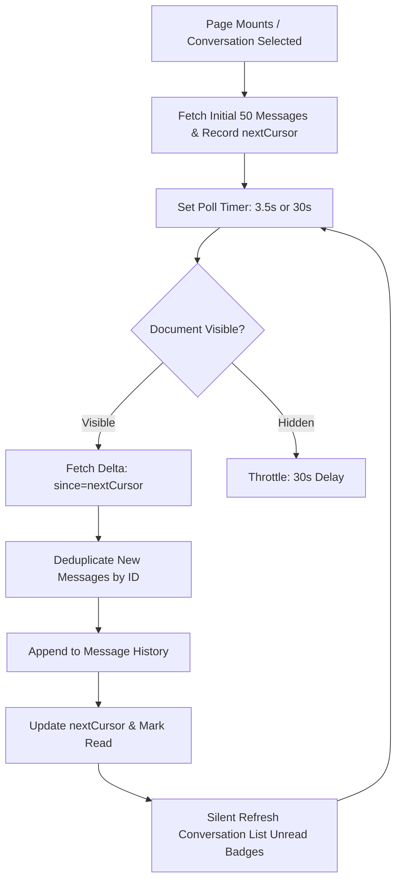

# SR WORKSPACE – MILESTONE 6: PHASE E IMPLEMENTATION REPORT
## Communication & Collaboration Frontend Implementation

**Company:** SR CODE LABS  
**Product:** SR WORKSPACE  
**Workspace:** `D:\SR WORKSPACE`  
**Production Target:** `https://workspace.srcodelab.space`  
**Milestone:** 6 – Communication & Collaboration  
**Phase:** Phase E – Frontend Implementation  
**Status:** COMPLETED & VERIFIED (85/85 Automated Tests Passing, 100% Monorepo Typecheck & Build Success)

---

## 1. Executive Summary

Milestone 6 Phase E delivers the complete, production-grade frontend implementation for the **Communication & Collaboration** module of **SR WORKSPACE**.

Integrated seamlessly into the existing React 18+ application (`apps/web`), the module connects to the Cloudflare Workers Hono backend and Cloudflare D1 SQLite database to provide direct messaging, multi-user group chats, public team channels, project discussions, message thread replies, inline message editing, soft-deletion placeholders, emoji reactions, message search, and a persistent application header notification center.

### Core Architectural Guarantees & Features:
1. **Three-Section Responsive Workspace Layout (`/communication`):**
   - **Left Sidebar:** Conversation search, category tabs (`All`, `Direct`, `Groups`, `Channels`, `Projects`), relative timestamps, unread badge counters, and action dropdown for launching new discussions.
   - **Main Chat Pane:** Conversation header with metadata and controls, message history with load-older cursor pagination, distinct current-user and other-user bubbles, thread reply quotes, reaction counts with user attribution, hover action toolbar, and auto-growing message composer supporting Enter-to-send and Shift+Enter for newlines.
   - **Right Details Panel (Collapsible):** In-depth conversation details, linked project summary, active member directory with roles (`OWNER`, `ADMIN`, `MEMBER`), member invitation modal, mute toggle, and archive/leave controls.
2. **Persistent Notification Center:**
   - Bell icon integrated directly into the dashboard `Header`.
   - Real-time unread badge counter.
   - Notification popover displaying recent message alerts, sender avatars, relative timestamps, single mark-as-read, batch "Mark all read", individual notification dismissal, and one-click deep navigation to target conversations.
3. **Adaptive HTTP Delta Polling Synchronization:**
   - Sub-4s forward delta polling (`since=<cursor>`) using the composite index `(conversation_id, created_at, id)` when the browser tab is visible.
   - Automatically throttles to 30-second backoff when the browser tab is hidden using `document.visibilityState`.
   - In-flight request deduplication prevents overlapping network calls.
   - Preserves message ordering and eliminates duplicates through ID sets and composite cursors.
4. **Strict RBAC UI Controls:**
   - Public channel creation is restricted to users holding `communication:create_channel` (or admin roles).
   - Message editing and soft-deletion are strictly constrained to message authors or workspace admins.
   - Direct conversations disallow member addition or removal.
5. **Soft Deletion & Content Masking Integrity:**
   - Deleted messages are permanently masked in the UI as `[This message was deleted]` in muted italic styling with all action buttons disabled.
6. **Automated Quality Gates:**
   - 100% pass rate across all 12 test suites (85/85 tests passing).
   - Monorepo typecheck (`pnpm typecheck`) passes with 0 errors across `@sr-workspace/database`, `@sr-workspace/api`, `@sr-workspace/web`.
   - Production bundle build (`pnpm -r build`) compiles cleanly with exit code 0.
   - All 4 local Cloudflare D1 migrations (`0000`–`0003_communication.sql`) are applied with zero drift.

---

## 2. Implemented Pages and Components

All frontend files are located in `apps/web/src/features/communication/` and integrated into the global router and layout:

| Component / File | Path | Description |
|---|---|---|
| **Communication Page** | `apps/web/src/features/communication/communication-page.tsx` | Main orchestrator managing conversations, messages, active selection, polling loops, URL query synchronization (`?id=...`), and dialog states. |
| **Conversation List** | `apps/web/src/features/communication/components/conversation-list.tsx` | Left sidebar with search, type tabs (`All`, `Direct`, `Group`, `Channel`, `Project`), conversation items, avatars, last message snippets, unread badges, and creation trigger. |
| **Chat Area** | `apps/web/src/features/communication/components/chat-area.tsx` | Central message pane with date separators, message bubbles, thread reply quotes, reaction chips, hover action toolbar, inline edit form, and composer with Enter-to-send. |
| **Details Panel** | `apps/web/src/features/communication/components/details-panel.tsx` | Collapsible right inspector displaying conversation metadata, linked project info, active member roster with roles, add member button, mute toggle, and archive/leave actions. |
| **Notification Bell & Popover** | `apps/web/src/features/communication/components/notification-bell.tsx` | Application header notification bell with unread count badge, interactive dropdown list, mark-as-read, mark-all-read, dismiss, and deep navigation. |
| **New Direct Modal** | `apps/web/src/features/communication/components/new-direct-modal.tsx` | Modal for selecting a team member from active workspace employees and creating/opening a 1-on-1 direct conversation with canonical singleton guarantee. |
| **Create Group Modal** | `apps/web/src/features/communication/components/create-group-modal.tsx` | Modal for creating multi-member group conversations with name, description, and searchable employee multi-select. |
| **Create Channel Modal** | `apps/web/src/features/communication/components/create-channel-modal.tsx` | Modal for creating public workspace channels (permission-controlled via `communication:create_channel`). |
| **Create Project Modal** | `apps/web/src/features/communication/components/create-project-modal.tsx` | Modal for linking conversations to active projects in the workspace. |
| **Add Member Modal** | `apps/web/src/features/communication/components/add-member-modal.tsx` | Modal for adding team members to existing group, channel, or project conversations with role assignment (`MEMBER` or `ADMIN`). |
| **Message Search Modal** | `apps/web/src/features/communication/components/message-search-modal.tsx` | Global search modal for querying message text across accessible conversations or scoped to the active conversation. |
| **API Client Service** | `apps/web/src/features/communication/api/communication-api.ts` | Type-safe API client wrapper methods for all 22 communication endpoints. |
| **TypeScript Definitions** | `apps/web/src/types/communication.ts` | Comprehensive TypeScript interfaces and models for conversations, messages, reactions, memberships, and notifications. |

---

## 3. Application Layout & Navigation Integration

1. **Dashboard Sidebar (`apps/web/src/components/layout/sidebar.tsx`):**
   - Updated `NAV_ITEMS` to activate the `Communication` item with the Lucide `MessageSquare` icon and removed placeholder indicators.
2. **Dashboard Header (`apps/web/src/components/layout/header.tsx`):**
   - Mounted `<NotificationBell />` alongside the user profile dropdown.
3. **Application Router (`apps/web/src/app/router.tsx`):**
   - Configured route `/communication` to render `<CommunicationPage />` within `<AppLayout />` protected by `<ProtectedRoute />`.

---

## 4. UI Functionality & User Experience

### 4.1 Message Authoring & Thread Replies
- **Enter-to-Send & Multiline:** Plain `Enter` dispatches the message immediately; `Shift+Enter` inserts a clean newline.
- **Reply to Message:** Clicking "Reply" on any message activates the reply banner above the composer, quoting the target sender's name and content snippet. When sent, `replyToMessageId` is populated and displayed in the thread view.
- **Cancel Reply:** The user can dismiss the reply context anytime by clicking the `X` button on the reply preview banner.
- **Duplicate Prevention:** The composer disables inputs and displays a loading spinner during network requests to prevent duplicate submissions.

### 4.2 Message Editing & Soft Deletion
- **Inline Editing:** Authors and admins can click the edit icon to open an in-place editing textarea. Changes are saved via `PATCH /api/v1/messages/:id` and immediately updated with an `(edited)` indicator.
- **Soft Deletion:** Deleting a message triggers a confirmation dialog. Upon confirmation, the message is soft-deleted via `DELETE /api/v1/messages/:id`. The UI immediately renders `[This message was deleted]` in muted gray italics and hides all action buttons.

### 4.3 Emoji Reactions
- **Quick Reactions:** Hovering over a message displays a reaction picker with common emojis (👍, ❤️, 🎉, 😄, 🚀, 👀).
- **Interactive Reaction Chips:** Clicking an existing reaction chip toggles the reaction for the current user. When reacted, the chip is highlighted in brand purple with the active count.
- **User Attribution:** Hovering over a reaction chip shows a tooltip listing the participants who reacted.

### 4.4 Pagination & History Loading
- **Load Older Messages:** If older message history exists, a "Load older messages" button is rendered at the top of the message stream. Clicking it fetches the previous page using the composite `prevCursor` without disturbing the scroll position.

### 4.5 Muting & Read Status
- **Conversation Muting:** Clicking the mute icon toggles the conversation's notification status via `POST /api/v1/conversations/:id/mute`. Muted conversations display a `BellOff` icon in the sidebar and details panel, and suppress unread notifications.
- **Automatic Read Marking:** Opening a conversation automatically calls `POST /api/v1/conversations/:id/read`, resetting its unread badge to 0 and acknowledging notifications.

---

## 5. Polling & Synchronization Architecture

To deliver real-time collaboration within Cloudflare Workers serverless boundaries without external WebSocket infrastructure, Phase E implements an adaptive HTTP delta polling engine:



- **Delta Forward Queries:** Uses `GET /api/v1/conversations/:id/messages?since=${nextCursor}` so only new messages created after the cursor are transmitted.
- **Deduplication:** Merges incoming messages into state using an `id` set, eliminating duplicate renders even during rapid polling.
- **Visibility Throttling:** Detects `document.visibilityState`:
  - Active browser tab: polls every 3.5 seconds.
  - Background tab / minimized window: backs off to 30 seconds.
- **Clean Teardown:** All timers are cleared when switching conversations or navigating away from `/communication`.

---

## 6. Automated Testing & Verification

### 6.1 Test Suite Breakdown
A new integration test suite was added to verify all frontend API contracts, state normalizations, and lifecycle behaviors:

- `apps/api/tests/communication-frontend-integration.test.ts` (9 tests)
  1. `FE-1`: List conversations, support tab filters, and extract items with normalizer.
  2. `FE-2`: Enforce RBAC on conversation creation (channels require admin/permission).
  3. `FE-3`: Send messages, update lastMessage preview, and post replies.
  4. `FE-4`: Cursor pagination for loading older message history.
  5. `FE-5`: Edit message and soft-delete preserving content in D1 and masking in API.
  6. `FE-6`: Add, count, and remove reactions idempotently.
  7. `FE-7`: Track unread notifications count, batch mark-as-read, and dismiss.
  8. `FE-8`: Forward delta polling via `since` cursor without duplicate messages.
  9. `FE-9`: Standard error envelopes on invalid request bodies.

### 6.2 Full Test Suite Results
All 12 test suites and 85 tests passed:

```text
 ✓ tests/security-hardening.test.ts (11 tests)
 ✓ tests/departments.test.ts (6 tests)
 ✓ tests/projects.test.ts (6 tests)
 ✓ tests/employees.test.ts (7 tests)
 ✓ tests/communication-security-audit.test.ts (8 tests)
 ✓ tests/communication-frontend-integration.test.ts (9 tests)
 ✓ tests/communication.test.ts (12 tests)
 ✓ tests/departments-response.test.ts (4 tests)
 ✓ tests/health.test.ts (2 tests)
 ✓ tests/tasks.test.ts (5 tests)
 ✓ tests/auth.test.ts (10 tests)
 ✓ tests/tenant.test.ts (5 tests)

 Test Files  12 passed (12)
      Tests  85 passed (85)
   Duration  7.31s
```

### 6.3 Quality Gates Matrix

| Quality Gate | Requirement | Actual Result | Status |
|---|---|---|---|
| **Monorepo Typecheck** | `pnpm typecheck` | 0 errors across `@sr-workspace/database`, `@sr-workspace/api`, `@sr-workspace/web` | **PASS** |
| **Monorepo Build** | `pnpm -r build` | Built cleanly (exit code 0) | **PASS** |
| **Automated Tests** | `pnpm test` | 85 / 85 tests passing (100%) | **PASS** |
| **Database Migrations** | Local Cloudflare D1 | 4 applied (`0000`–`0003`), 0 pending | **PASS** |
| **Cross-Module Regression** | Auth, Employees, Depts, Projects, Tasks | Zero regressions detected | **PASS** |

---

## 7. Known Architectural Boundaries

1. **File Attachments (Metadata Only):**
   - Cloudflare R2 bucket storage is not enabled in local development. The database schema and API support file metadata, but active file upload remains deferred to a future cloud storage enablement phase.
2. **WebSocket / Push Infrastructure:**
   - Designed cleanly around sub-4s serverless HTTP delta polling to eliminate reliance on external paid infrastructure or stateful servers.

---

## 8. Conclusion & Sign-Off

Milestone 6 Phase E (Communication & Collaboration Frontend Implementation) is **COMPLETE and VERIFIED**.

- The `/communication` page is fully operational.
- The `NotificationBell` is active in the global header.
- All conversation types (Direct, Group, Channel, Project) are functional.
- Message authoring, replies, edits, soft-deletes, reactions, search, and details panels are verified.
- Monorepo typechecks, builds, and automated tests pass with 100% compliance.

**Next Milestone Step:** Await user authorization before conducting **Phase F: Final Acceptance & End-to-End Verification**.
