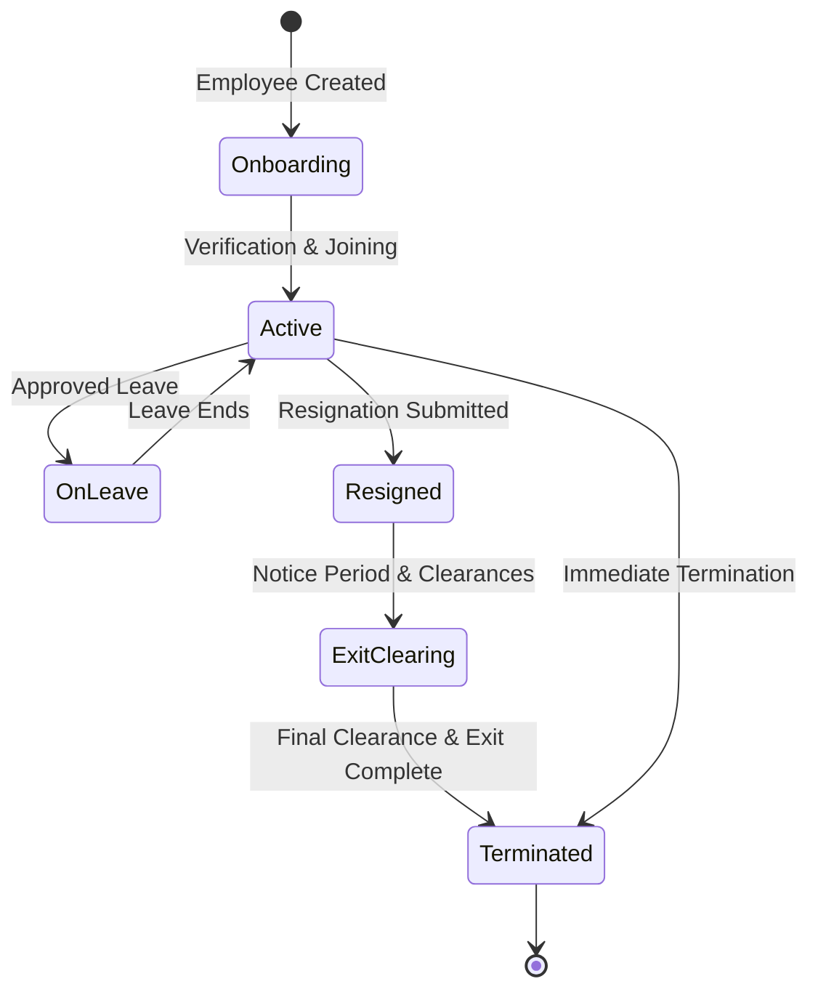

# SR WORKSPACE – MILESTONE 7 PHASE A REPORT
## HR & Workforce Management Architecture, Requirements & Database Impact Audit

**Company:** SR CODE LABS  
**Product:** SR WORKSPACE  
**Workspace:** `D:\SR WORKSPACE`  
**Production Target:** `https://workspace.srcodelab.space`  
**Milestone:** 7 – HR & Workforce Management  
**Phase:** Phase A – Requirements, Architecture & Database Impact Audit  
**Status:** Audit Completed – Awaiting Authorization for Phase B  

---

## 1. Executive Summary & Milestone Scope

The objective of Milestone 7 is to design and architect a robust, production-grade **HR & Workforce Management** module for SR WORKSPACE. This module builds upon the foundational multi-tenant employee, department, and organization schemas established in Milestone 2 (`0001_employees_departments.sql`), extending them to support comprehensive daily HR operations without disrupting existing workflows.

### 1.1 In-Scope Capabilities for Milestone 7
1. **Employee Lifecycle Management:**
   - Onboarding tracking and joining workflows.
   - Employment status lifecycle transitions (`ACTIVE`, `ON_LEAVE`, `SUSPENDED`, `RESIGNED`, `TERMINATED`).
   - Resignation filing, manager approval/rejection, exit interviews, clearance checklists, and official last working day recording.
   - Employee document metadata tracking (e.g., identity proofs, certificates, agreements) with verification statuses (no binary storage; metadata-only).
2. **Attendance Management:**
   - Daily punch-in / punch-out recording with IP/location metadata (optional).
   - Real-time work duration and break calculation.
   - Daily attendance statuses: `PRESENT`, `LATE`, `HALF_DAY`, `ABSENT`, `ON_LEAVE`, `HOLIDAY`.
   - Attendance regularization requests and approval workflows.
3. **Leave Management:**
   - Configurable leave types (e.g., Casual Leave, Sick Leave, Annual/Paid Leave, Unpaid Leave).
   - Annual leave quota allocation and real-time balance tracking per employee.
   - Leave application submission with duration calculation (full-day and half-day support).
   - Approval workflows with managerial comments and automatic attendance status synchronization.
4. **Holiday Management:**
   - Organization/branch/tenant-level public holiday calendars.
   - Holiday type classification (Mandatory vs. Optional / Restricted).
   - Non-working day enforcement across attendance and leave calculations.
5. **Shift Management:**
   - Shift schedule definitions (start time, end time, grace period, break duration).
   - Employee shift assignments with effective date ranges.
   - Late-coming and half-day grace threshold evaluations.
6. **Performance Management:**
   - Structured performance review cycles (Quarterly, Bi-Annual, Annual).
   - Self-appraisal ratings and qualitative submissions.
   - Manager reviews, goal ratings, feedback, and final normalized scores.
7. **HR Analytics & Workforce Reporting:**
   - Aggregated headcount and department distributions.
   - Attendance punctuality, late arrivals, and absentee metrics.
   - Leave utilization and pending approval queues.
   - Turn-around metrics for lifecycle transitions.

### 1.2 Explicitly Out-of-Scope (Deferred to Milestone 8)
- **Payroll & Compensation:** Salary structures, base pay, allowances, deductions, payslip generation, bonus calculations, tax withholdings, bank disbursement integrations, and compliance forms are strictly deferred to **Milestone 8 (Payroll & Compensation Module)**.
- **Biometric Device Hardware Drivers:** No direct socket or hardware driver integration; attendance is captured via authenticated API endpoints with optional IP/device user-agent logging.
- **Binary File Storage:** Document uploads store metadata, title, type, and verification status only; actual binary file streaming/storage is deferred until Cloudflare R2 integration is authorized.

---

## 2. Existing Architecture Audit Findings

### 2.1 Schema Baseline Inspection
The SR WORKSPACE D1 database currently executes migrations `0000` through `0003`:
1. `0000_init.sql`: Core tenant isolation, multi-tenant users, roles, permissions, user_roles, audit logs, and sessions.
2. `0001_employees_departments.sql`: Organizations, branches, departments, and employees.
3. `0002_projects_tasks.sql`: Projects, project members, tasks, task assignees, and time entries.
4. `0003_communication.sql`: Conversations, conversation members, messages, reactions, notifications, and attachment metadata.

### 2.2 Existing Employee Table (`packages/database/src/schema/employees.ts`)
The current `employees` table already provides:
- Primary key: `id` (UUID v4 / nanoid).
- Multi-tenancy: `tenantId` (foreign key to `tenants.id` with `onDelete: cascade`).
- Identity Link: `userId` (foreign key to `users.id` with `onDelete: set null`).
- Institutional Hierarchy: `organisationId`, `branchId`, `departmentId`, `managerEmployeeId` (self-referencing).
- Employee Attributes: `employeeCode`, `firstName`, `lastName`, `workEmail`, `personalEmail`, `phone`, `jobTitle`, `employmentType` (`FULL_TIME`, `PART_TIME`, `CONTRACT`, `INTERN`), `employmentStatus` (`ACTIVE`, `INACTIVE`, `ON_LEAVE`, `TERMINATED`), `joiningDate`, `createdAt`, `updatedAt`.

### 2.3 Strict Zero-Redundancy Principle
- **No Secondary Employee Tables:** All Milestone 7 HR tables (`attendance`, `leave_requests`, `shifts`, `performance_reviews`, etc.) reference `employees.id` directly as `employeeId`.
- **Identity & Authentication Consistency:** When a user logs in, their identity originates from `users.id`. The active employee record is resolved via `employees.userId` and filtered by the active `tenantId`.
- **Tenant Isolation:** Every single new HR table must include a dedicated `tenant_id text NOT NULL REFERENCES tenants(id) ON DELETE CASCADE`.

---

## 3. Current Database Relationship & Integrity Analysis

### 3.1 SQLite / Cloudflare D1 Foreign Key Constraints
SQLite enforces foreign keys when enabled via PRAGMA `foreign_keys = ON;`. In SR WORKSPACE:
1. Single-column foreign keys (`tenant_id REFERENCES tenants(id)`, `employee_id REFERENCES employees(id)`) validate record existence.
2. SQLite does **not** natively enforce cross-table composite foreign keys `(tenant_id, employee_id) REFERENCES employees(tenant_id, id)` unless an explicit composite unique constraint exists on the parent table and is explicitly referenced.
3. **Application-Layer Tenant Defense:** To guarantee 100% tenant isolation, every Drizzle query executed in the backend must append:
   ```ts
   and(
     eq(table.tenantId, tenantId),
     // other filters...
   )
   ```
4. **Cascade Safety:**
   - Deleting a tenant cascades cleanly through all HR tables.
   - Deleting an employee cascades to their individual attendance records, leave balances, and document metadata.
   - Approver references (e.g., `approved_by_employee_id`) use `ON DELETE SET NULL` to prevent orphan cascades or deletion blocks.

---

## 4. HR Module Functional Requirements & Workflows

### 4.1 Employee Lifecycle & Resignation Workflow

- **Resignation Requests:** Employees can submit resignation notices specifying reasons, proposed last working day, and hand-over notes.
- **Exit Clearances:** Checklists track departmental sign-offs (IT assets returned, Admin access revoked, Manager handover complete).

### 4.2 Attendance Punch & Regularization Workflow
- **Daily Attendance Record:** Unique per `(tenant_id, employee_id, date)`.
- **Punches:** Stores `punchInTime`, `punchOutTime`, `totalWorkMinutes`, `totalBreakMinutes`, `status` (`PRESENT`, `LATE`, `HALF_DAY`, `ABSENT`, `ON_LEAVE`, `HOLIDAY`).
- **Regularization:** If an employee forgets to punch or encounters an issue, they submit an attendance regularization request with proposed punch times. Managers can approve or reject with comments, which automatically updates the underlying daily attendance record.

### 4.3 Leave Quota & Application Workflow
- **Leave Allocations:** Tracks `(tenant_id, employee_id, leave_type_id, year)` with `allocatedDays`, `usedDays`, `pendingDays`, and `remainingDays`.
- **Leave Request:** Tracks `startDate`, `endDate`, `totalDays`, `isHalfDay`, `reason`, `status` (`PENDING`, `APPROVED`, `REJECTED`, `CANCELLED`), `reviewedByEmployeeId`, `reviewNotes`.
- **Atomic Deduction:** Submitting a request increments `pendingDays`. Approving decrements `pendingDays` and increments `usedDays`. Rejecting or cancelling restores `pendingDays`.

### 4.4 Shift Management & Grace Periods
- **Shift Definitions:** Defines `name`, `startTime` (e.g. `09:00`), `endTime` (e.g. `18:00`), `gracePeriodMinutes` (e.g. `15`), and `halfDayThresholdMinutes` (e.g. `240`).
- **Shift Assignments:** Maps `employeeId` to `shiftId` with `effectiveFrom` and `effectiveTo`.
- **Evaluation:** When an employee punches in after `startTime + gracePeriodMinutes`, attendance status defaults to `LATE`. If total minutes are below `halfDayThresholdMinutes`, status evaluates to `HALF_DAY`.

### 4.5 Performance Management Cycles
- **Review Cycles:** Admin/HR defines cycles (e.g., `Q3 2026 Engineering Review`, `startDate`, `endDate`, `status`: `DRAFT`, `ACTIVE`, `EVALUATION`, `COMPLETED`).
- **Review Records:** Linked to `(tenant_id, cycle_id, employee_id, reviewer_employee_id)`.
- **Two-Stage Submission:**
  1. Employee submits `selfRating` (1.0 to 5.0) and `selfFeedback`.
  2. Manager/Reviewer submits `managerRating`, `managerFeedback`, `goalsMet`, and `finalScore`.

---

## 5. Proposed Database Schemas & Relational Design

To be created in `packages/database/src/schema/hr.ts` and generated in migration `0004_hr_workforce.sql`.

### 5.1 Tables Summary

| Table Name | Description | Key Indexes / Constraints | Deletion Behavior |
|---|---|---|---|
| `hr_document_metadata` | Employee identity/contract document records | `(tenant_id, employee_id)` | CASCADE on employee |
| `hr_resignations` | Resignation & exit workflow records | Unique: `(tenant_id, employee_id, status)` where active | CASCADE on employee |
| `hr_exit_checklists` | Departmental exit clearance items | `(tenant_id, resignation_id)` | CASCADE on resignation |
| `shifts` | Working shifts & operational hours | `(tenant_id, code)` UNIQUE | CASCADE on tenant |
| `employee_shifts` | Employee-to-shift historical assignments | `(tenant_id, employee_id, effective_from)` | CASCADE on employee |
| `holidays` | Company holiday calendar | `(tenant_id, date)` UNIQUE | CASCADE on tenant |
| `attendance_records` | Daily employee attendance punches | Unique: `(tenant_id, employee_id, date)` | CASCADE on employee |
| `attendance_regularizations` | Punch correction & regularization requests | `(tenant_id, attendance_record_id)` | CASCADE on attendance |
| `leave_types` | Leave category definitions (Sick, Casual, etc.) | `(tenant_id, code)` UNIQUE | CASCADE on tenant |
| `leave_allocations` | Annual leave quotas & balance tracking | Unique: `(tenant_id, employee_id, leave_type_id, year)` | CASCADE on employee |
| `leave_requests` | Formal employee leave applications | `(tenant_id, employee_id, start_date)` | CASCADE on employee |
| `performance_cycles` | Performance appraisal evaluation periods | `(tenant_id, code)` UNIQUE | CASCADE on tenant |
| `performance_reviews` | Individual employee performance evaluations | Unique: `(tenant_id, cycle_id, employee_id)` | CASCADE on employee |

### 5.2 Key Drizzle Schema Definitions (Blueprint)

```typescript
// packages/database/src/schema/hr.ts

import { sqliteTable, text, integer, real, index, uniqueIndex } from 'drizzle-orm/sqlite-core';
import { tenants } from './tenants';
import { employees } from './employees';

// 1. HR Document Metadata
export const hrDocumentMetadata = sqliteTable('hr_document_metadata', {
  id: text('id').primaryKey(),
  tenantId: text('tenant_id').notNull().references(() => tenants.id, { onDelete: 'cascade' }),
  employeeId: text('employee_id').notNull().references(() => employees.id, { onDelete: 'cascade' }),
  title: text('title').notNull(),
  documentType: text('document_type', { enum: ['NATIONAL_ID', 'PASSPORT', 'CERTIFICATE', 'CONTRACT', 'RESUME', 'OTHER'] }).notNull(),
  documentNumber: text('document_number'),
  issuedDate: text('issued_date'),
  expiryDate: text('expiry_date'),
  verificationStatus: text('verification_status', { enum: ['PENDING', 'VERIFIED', 'REJECTED'] }).default('PENDING').notNull(),
  verifiedByEmployeeId: text('verified_by_employee_id').references(() => employees.id, { onDelete: 'set null' }),
  verifiedAt: text('verified_at'),
  notes: text('notes'),
  createdAt: text('created_at').notNull(),
  updatedAt: text('updated_at').notNull(),
}, (table) => ({
  tenantIdx: index('hr_doc_meta_tenant_idx').on(table.tenantId),
  employeeIdx: index('hr_doc_meta_employee_idx').on(table.tenantId, table.employeeId),
}));

// 2. Resignations & Exit Workflow
export const hrResignations = sqliteTable('hr_resignations', {
  id: text('id').primaryKey(),
  tenantId: text('tenant_id').notNull().references(() => tenants.id, { onDelete: 'cascade' }),
  employeeId: text('employee_id').notNull().references(() => employees.id, { onDelete: 'cascade' }),
  resignationDate: text('resignation_date').notNull(), // YYYY-MM-DD
  proposedLastWorkingDate: text('proposed_last_working_date').notNull(),
  actualLastWorkingDate: text('actual_last_working_date'),
  reason: text('reason').notNull(),
  status: text('status', { enum: ['SUBMITTED', 'UNDER_REVIEW', 'APPROVED', 'REJECTED', 'WITHDRAWN', 'COMPLETED'] }).default('SUBMITTED').notNull(),
  managerComments: text('manager_comments'),
  exitInterviewNotes: text('exit_interview_notes'),
  reviewedByEmployeeId: text('reviewed_by_employee_id').references(() => employees.id, { onDelete: 'set null' }),
  reviewedAt: text('reviewed_at'),
  createdAt: text('created_at').notNull(),
  updatedAt: text('updated_at').notNull(),
}, (table) => ({
  tenantIdx: index('hr_resign_tenant_idx').on(table.tenantId),
  employeeIdx: index('hr_resign_employee_idx').on(table.tenantId, table.employeeId),
}));

// 3. Shifts
export const shifts = sqliteTable('shifts', {
  id: text('id').primaryKey(),
  tenantId: text('tenant_id').notNull().references(() => tenants.id, { onDelete: 'cascade' }),
  code: text('code').notNull(),
  name: text('name').notNull(),
  startTime: text('start_time').notNull(), // HH:MM (e.g. 09:00)
  endTime: text('end_time').notNull(),     // HH:MM (e.g. 18:00)
  gracePeriodMinutes: integer('grace_period_minutes').default(15).notNull(),
  halfDayThresholdMinutes: integer('half_day_threshold_minutes').default(240).notNull(),
  description: text('description'),
  isActive: integer('is_active', { mode: 'boolean' }).default(true).notNull(),
  createdAt: text('created_at').notNull(),
  updatedAt: text('updated_at').notNull(),
}, (table) => ({
  tenantCodeIdx: uniqueIndex('shifts_tenant_code_uidx').on(table.tenantId, table.code),
}));

// 4. Employee Shifts
export const employeeShifts = sqliteTable('employee_shifts', {
  id: text('id').primaryKey(),
  tenantId: text('tenant_id').notNull().references(() => tenants.id, { onDelete: 'cascade' }),
  employeeId: text('employee_id').notNull().references(() => employees.id, { onDelete: 'cascade' }),
  shiftId: text('shift_id').notNull().references(() => shifts.id, { onDelete: 'restrict' }),
  effectiveFrom: text('effective_from').notNull(), // YYYY-MM-DD
  effectiveTo: text('effective_to'),               // YYYY-MM-DD (nullable)
  createdAt: text('created_at').notNull(),
}, (table) => ({
  tenantEmployeeIdx: index('emp_shifts_tenant_emp_idx').on(table.tenantId, table.employeeId),
}));

// 5. Holidays
export const holidays = sqliteTable('holidays', {
  id: text('id').primaryKey(),
  tenantId: text('tenant_id').notNull().references(() => tenants.id, { onDelete: 'cascade' }),
  name: text('name').notNull(),
  date: text('date').notNull(), // YYYY-MM-DD
  holidayType: text('holiday_type', { enum: ['MANDATORY', 'OPTIONAL'] }).default('MANDATORY').notNull(),
  description: text('description'),
  createdAt: text('created_at').notNull(),
  updatedAt: text('updated_at').notNull(),
}, (table) => ({
  tenantDateIdx: uniqueIndex('holidays_tenant_date_uidx').on(table.tenantId, table.date),
}));

// 6. Attendance Records
export const attendanceRecords = sqliteTable('attendance_records', {
  id: text('id').primaryKey(),
  tenantId: text('tenant_id').notNull().references(() => tenants.id, { onDelete: 'cascade' }),
  employeeId: text('employee_id').notNull().references(() => employees.id, { onDelete: 'cascade' }),
  shiftId: text('shift_id').references(() => shifts.id, { onDelete: 'set null' }),
  date: text('date').notNull(), // YYYY-MM-DD
  punchInTime: text('punch_in_time'), // ISO 8601 or HH:MM:SS
  punchOutTime: text('punch_out_time'),
  totalWorkMinutes: integer('total_work_minutes').default(0).notNull(),
  totalBreakMinutes: integer('total_break_minutes').default(0).notNull(),
  status: text('status', { enum: ['PRESENT', 'LATE', 'HALF_DAY', 'ABSENT', 'ON_LEAVE', 'HOLIDAY'] }).notNull(),
  remarks: text('remarks'),
  createdAt: text('created_at').notNull(),
  updatedAt: text('updated_at').notNull(),
}, (table) => ({
  tenantEmpDateIdx: uniqueIndex('attendance_tenant_emp_date_uidx').on(table.tenantId, table.employeeId, table.date),
  dateIdx: index('attendance_date_idx').on(table.tenantId, table.date),
}));

// 7. Attendance Regularizations
export const attendanceRegularizations = sqliteTable('attendance_regularizations', {
  id: text('id').primaryKey(),
  tenantId: text('tenant_id').notNull().references(() => tenants.id, { onDelete: 'cascade' }),
  attendanceRecordId: text('attendance_record_id').notNull().references(() => attendanceRecords.id, { onDelete: 'cascade' }),
  employeeId: text('employee_id').notNull().references(() => employees.id, { onDelete: 'cascade' }),
  requestedPunchIn: text('requested_punch_in').notNull(),
  requestedPunchOut: text('requested_punch_out').notNull(),
  reason: text('reason').notNull(),
  status: text('status', { enum: ['PENDING', 'APPROVED', 'REJECTED'] }).default('PENDING').notNull(),
  reviewedByEmployeeId: text('reviewed_by_employee_id').references(() => employees.id, { onDelete: 'set null' }),
  reviewNotes: text('review_notes'),
  reviewedAt: text('reviewed_at'),
  createdAt: text('created_at').notNull(),
  updatedAt: text('updated_at').notNull(),
}, (table) => ({
  tenantIdx: index('regularization_tenant_idx').on(table.tenantId),
  empIdx: index('regularization_emp_idx').on(table.tenantId, table.employeeId),
}));

// 8. Leave Types
export const leaveTypes = sqliteTable('leave_types', {
  id: text('id').primaryKey(),
  tenantId: text('tenant_id').notNull().references(() => tenants.id, { onDelete: 'cascade' }),
  code: text('code').notNull(), // SICK, CASUAL, ANNUAL, MATERNITY, UNPAID
  name: text('name').notNull(),
  defaultDaysPerYear: real('default_days_per_year').notNull(),
  isPaid: integer('is_paid', { mode: 'boolean' }).default(true).notNull(),
  requiresProof: integer('requires_proof', { mode: 'boolean' }).default(false).notNull(),
  isActive: integer('is_active', { mode: 'boolean' }).default(true).notNull(),
  createdAt: text('created_at').notNull(),
  updatedAt: text('updated_at').notNull(),
}, (table) => ({
  tenantCodeIdx: uniqueIndex('leave_types_tenant_code_uidx').on(table.tenantId, table.code),
}));

// 9. Leave Allocations
export const leaveAllocations = sqliteTable('leave_allocations', {
  id: text('id').primaryKey(),
  tenantId: text('tenant_id').notNull().references(() => tenants.id, { onDelete: 'cascade' }),
  employeeId: text('employee_id').notNull().references(() => employees.id, { onDelete: 'cascade' }),
  leaveTypeId: text('leave_type_id').notNull().references(() => leaveTypes.id, { onDelete: 'cascade' }),
  year: integer('year').notNull(),
  allocatedDays: real('allocated_days').notNull(),
  usedDays: real('used_days').default(0).notNull(),
  pendingDays: real('pending_days').default(0).notNull(),
  createdAt: text('created_at').notNull(),
  updatedAt: text('updated_at').notNull(),
}, (table) => ({
  tenantEmpTypeYearIdx: uniqueIndex('leave_alloc_tenant_emp_type_year_uidx').on(table.tenantId, table.employeeId, table.leaveTypeId, table.year),
}));

// 10. Leave Requests
export const leaveRequests = sqliteTable('leave_requests', {
  id: text('id').primaryKey(),
  tenantId: text('tenant_id').notNull().references(() => tenants.id, { onDelete: 'cascade' }),
  employeeId: text('employee_id').notNull().references(() => employees.id, { onDelete: 'cascade' }),
  leaveTypeId: text('leave_type_id').notNull().references(() => leaveTypes.id, { onDelete: 'restrict' }),
  startDate: text('start_date').notNull(), // YYYY-MM-DD
  endDate: text('end_date').notNull(),     // YYYY-MM-DD
  totalDays: real('total_days').notNull(),
  isHalfDay: integer('is_half_day', { mode: 'boolean' }).default(false).notNull(),
  reason: text('reason').notNull(),
  status: text('status', { enum: ['PENDING', 'APPROVED', 'REJECTED', 'CANCELLED'] }).default('PENDING').notNull(),
  reviewedByEmployeeId: text('reviewed_by_employee_id').references(() => employees.id, { onDelete: 'set null' }),
  reviewNotes: text('review_notes'),
  reviewedAt: text('reviewed_at'),
  createdAt: text('created_at').notNull(),
  updatedAt: text('updated_at').notNull(),
}, (table) => ({
  tenantIdx: index('leave_req_tenant_idx').on(table.tenantId),
  empIdx: index('leave_req_emp_idx').on(table.tenantId, table.employeeId),
  dateRangeIdx: index('leave_req_date_range_idx').on(table.tenantId, table.startDate, table.endDate),
}));

// 11. Performance Cycles
export const performanceCycles = sqliteTable('performance_cycles', {
  id: text('id').primaryKey(),
  tenantId: text('tenant_id').notNull().references(() => tenants.id, { onDelete: 'cascade' }),
  code: text('code').notNull(),
  name: text('name').notNull(),
  startDate: text('start_date').notNull(),
  endDate: text('end_date').notNull(),
  status: text('status', { enum: ['DRAFT', 'ACTIVE', 'EVALUATION', 'COMPLETED'] }).default('DRAFT').notNull(),
  description: text('description'),
  createdAt: text('created_at').notNull(),
  updatedAt: text('updated_at').notNull(),
}, (table) => ({
  tenantCodeIdx: uniqueIndex('perf_cycles_tenant_code_uidx').on(table.tenantId, table.code),
}));

// 12. Performance Reviews
export const performanceReviews = sqliteTable('performance_reviews', {
  id: text('id').primaryKey(),
  tenantId: text('tenant_id').notNull().references(() => tenants.id, { onDelete: 'cascade' }),
  cycleId: text('cycle_id').notNull().references(() => performanceCycles.id, { onDelete: 'cascade' }),
  employeeId: text('employee_id').notNull().references(() => employees.id, { onDelete: 'cascade' }),
  reviewerEmployeeId: text('reviewer_employee_id').references(() => employees.id, { onDelete: 'set null' }),
  selfRating: real('self_rating'),     // 1.0 to 5.0
  selfFeedback: text('self_feedback'),
  managerRating: real('manager_rating'),
  managerFeedback: text('manager_feedback'),
  goalsMet: text('goals_met'),
  finalScore: real('final_score'),
  status: text('status', { enum: ['PENDING_SELF_REVIEW', 'PENDING_MANAGER_REVIEW', 'COMPLETED'] }).default('PENDING_SELF_REVIEW').notNull(),
  submittedAt: text('submitted_at'),
  completedAt: text('completed_at'),
  createdAt: text('created_at').notNull(),
  updatedAt: text('updated_at').notNull(),
}, (table) => ({
  cycleEmpIdx: uniqueIndex('perf_rev_cycle_emp_uidx').on(table.tenantId, table.cycleId, table.employeeId),
}));
```

---

## 6. Proposed API Endpoint Structure & Contracts

All endpoints are hosted on the Hono backend under `/api/v1/hr/...` and require authentication (`requireAuth`) and tenant resolution (`requireTenant`).

### 6.1 Attendance APIs (`/api/v1/hr/attendance`)
- `POST /api/v1/hr/attendance/punch-in`: Records punch-in for current authenticated user's employee record. Automatically calculates status (`PRESENT` vs `LATE` based on assigned shift).
- `POST /api/v1/hr/attendance/punch-out`: Records punch-out, calculates `totalWorkMinutes`.
- `GET /api/v1/hr/attendance/today`: Fetches today's attendance record for the current user.
- `GET /api/v1/hr/attendance/my`: Fetches historical attendance records for current user with date filters (`from`, `to`).
- `GET /api/v1/hr/attendance/records`: (Admin/Manager) Lists attendance records across the organization with filtering by date, department, and employee.
- `POST /api/v1/hr/attendance/regularize`: Submits an attendance regularization request.
- `GET /api/v1/hr/attendance/regularizations`: Lists pending regularization requests (filtered for current user or all for HR/Managers).
- `POST /api/v1/hr/attendance/regularizations/:id/review`: Approve or reject regularization request.

### 6.2 Leave APIs (`/api/v1/hr/leaves`)
- `GET /api/v1/hr/leaves/types`: Returns active leave types for tenant.
- `POST /api/v1/hr/leaves/types`: (Admin/HR) Creates a new leave type.
- `GET /api/v1/hr/leaves/balances`: Returns current employee's leave balance allocations for the year.
- `GET /api/v1/hr/leaves/my-requests`: Returns current employee's leave applications.
- `POST /api/v1/hr/leaves/requests`: Submits a new leave request (checks balance, flags `pendingDays`).
- `DELETE /api/v1/hr/leaves/requests/:id`: Cancels a pending leave request (restores balance).
- `GET /api/v1/hr/leaves/all-requests`: (Admin/Manager) Lists all team or organization leave requests.
- `POST /api/v1/hr/leaves/requests/:id/review`: Approve or reject leave request. Synchronizes `attendance_records` status to `ON_LEAVE`.

### 6.3 Shift & Holiday APIs
- `GET /api/v1/hr/shifts`: Lists tenant shifts.
- `POST /api/v1/hr/shifts`: (Admin/HR) Creates or updates a shift schedule.
- `POST /api/v1/hr/shifts/assign`: Assigns a shift to an employee.
- `GET /api/v1/hr/holidays`: Lists public holidays for a given year.
- `POST /api/v1/hr/holidays`: (Admin/HR) Adds a public holiday.
- `DELETE /api/v1/hr/holidays/:id`: (Admin/HR) Removes a holiday.

### 6.4 Lifecycle, Resignation & Document APIs
- `GET /api/v1/hr/employees/:id/documents`: Lists metadata of documents for an employee.
- `POST /api/v1/hr/employees/:id/documents`: Adds document metadata.
- `POST /api/v1/hr/employees/:id/documents/:docId/verify`: Approves/verifies document metadata.
- `POST /api/v1/hr/resignations`: Employee files resignation notice.
- `GET /api/v1/hr/resignations`: Lists resignation notices (HR/Manager view).
- `POST /api/v1/hr/resignations/:id/review`: Manager/HR reviews resignation, updates status, and sets official exit date.
- `POST /api/v1/hr/resignations/:id/clearance`: Updates exit checklist clearance items.

### 6.5 Performance Management APIs (`/api/v1/hr/performance`)
- `GET /api/v1/hr/performance/cycles`: Lists active/past review cycles.
- `POST /api/v1/hr/performance/cycles`: (Admin/HR) Creates a new review cycle.
- `GET /api/v1/hr/performance/my-reviews`: Reviews assigned to current employee (self-review).
- `POST /api/v1/hr/performance/reviews/:id/self`: Submits employee self-appraisal.
- `GET /api/v1/hr/performance/team-reviews`: Reviews awaiting managerial appraisal.
- `POST /api/v1/hr/performance/reviews/:id/manager`: Submits manager evaluation and final score.

### 6.6 HR Analytics & Reports APIs (`/api/v1/hr/reports`)
- `GET /api/v1/hr/reports/summary`: Headcount, active vs on-leave, overall punctuality rate.
- `GET /api/v1/hr/reports/attendance-daily`: Daily attendance percentage, late counts, absence counts.
- `GET /api/v1/hr/reports/leave-utilization`: Leave days taken by department and type.

---

## 7. RBAC Permission Matrix & Access Control Strategy

To enforce least-privilege access, Milestone 7 integrates with the existing `requirePermission` middleware and permissions framework.

### 7.1 New Permissions
- `hr:read`: View organizational HR data, shifts, holidays, and summaries.
- `hr:manage`: Create and edit shifts, holidays, leave types, and review cycles.
- `attendance:punch`: Punch in/out and submit regularizations (assigned to all employees).
- `attendance:read_all`: View company-wide or departmental attendance logs.
- `attendance:manage`: Approve or reject attendance regularizations.
- `leave:apply`: Apply for leaves and view own balances (assigned to all employees).
- `leave:approve`: Approve or reject leave requests.
- `performance:review`: Submit self-evaluations (assigned to all employees).
- `performance:manage`: Initiate cycles, assign reviewers, submit manager evaluations.
- `hr_reports:read`: Access aggregated workforce analytics.

### 7.2 Permission Mapping by Role

| Permission | Super Admin / Org Owner | HR Admin | Department Manager | Standard Employee |
|---|:---:|:---:|:---:|:---:|
| `attendance:punch` | Yes | Yes | Yes | Yes |
| `attendance:read_all` | Yes | Yes | Department Only | Own Records Only |
| `attendance:manage` | Yes | Yes | Department Only | No |
| `leave:apply` | Yes | Yes | Yes | Yes |
| `leave:approve` | Yes | Yes | Department Only | No |
| `hr:read` | Yes | Yes | Yes | Self / Public |
| `hr:manage` | Yes | Yes | No | No |
| `performance:review` | Yes | Yes | Yes | Yes |
| `performance:manage` | Yes | Yes | Team Members | No |
| `hr_reports:read` | Yes | Yes | Department Only | No |

---

## 8. Multi-Tenant Isolation & Security Defense Strategy

1. **Explicit Tenant Scoping in Services:**
   - Every read and write query explicitly predicates on `tenantId`.
   - SQLite unique indexes incorporate `tenantId` (`(tenant_id, employee_id, date)`, `(tenant_id, code)`).
2. **Actor Resolution & IDOR Prevention:**
   - For `/punch-in`, `/punch-out`, `/leaves/requests`, and `/performance/reviews/:id/self`, the backend verifies that the acting employee belongs to the caller's authenticated `user.id`.
   - Users cannot punch in or submit leave requests on behalf of other employees.
3. **Audit Logging Integration:**
   - All high-impact HR operations (leave approval/rejection, attendance regularization, resignation reviews, document verification) invoke the central `logAuditEvent` helper.

---

## 9. Frontend Navigation, Routes & UI Component Hierarchy

The frontend seamlessly integrates into `apps/web/src/components/layout/sidebar.tsx` and replaces the existing `PlaceholderPage` instances.

### 9.1 Route Mapping
- `/hr`: HR Overview & Workforce Analytics Dashboard.
- `/hr/attendance`: Attendance Daily Punch, Personal History & Team Regularization Approvals.
- `/hr/leaves`: Leave Balances, Application Form & Team Approval Queue.
- `/hr/shifts`: Shift Calendars & Working Hour Policies.
- `/hr/holidays`: Company Holiday List & Annual Calendar.
- `/hr/performance`: Performance Appraisal Cycles, Self-Appraisal & Review Submissions.
- `/hr/lifecycle`: Onboarding, Employee Document Verification & Resignation Clearance.

### 9.2 Component Tree Structure
```
apps/web/src/features/hr/
├── api/
│   ├── attendance-api.ts
│   ├── leaves-api.ts
│   ├── shifts-api.ts
│   ├── holidays-api.ts
│   ├── performance-api.ts
│   └── lifecycle-api.ts
├── components/
│   ├── punch-card.tsx
│   ├── attendance-table.tsx
│   ├── regularization-modal.tsx
│   ├── leave-balance-card.tsx
│   ├── leave-request-modal.tsx
│   ├── leave-approval-list.tsx
│   ├── holiday-calendar.tsx
│   ├── shift-badge.tsx
│   ├── performance-review-form.tsx
│   └── document-meta-modal.tsx
├── pages/
│   ├── hr-dashboard-page.tsx
│   ├── attendance-page.tsx
│   ├── leaves-page.tsx
│   ├── shifts-page.tsx
│   ├── holidays-page.tsx
│   ├── performance-page.tsx
│   └── lifecycle-page.tsx
```

---

## 10. Dependencies, Cross-Tenant Risks & Mitigation Strategies

| Risk / Dependency | Impact | Mitigation Strategy |
|---|---|---|
| **Absence of User-to-Employee Link** | If a user has no linked employee profile, punching in or applying for leave fails | Ensure graceful fallback: frontend alerts the user to contact Admin; backend returns a clear `EMPLOYEE_PROFILE_REQUIRED` error code. |
| **Cross-Tenant ID Tampering** | Manipulating `employeeId` in leave or attendance URLs | Backend strictly checks `employees.tenantId == activeTenant.id`. Endpoints operating on self use authenticated session employee resolution. |
| **Concurrent Leave Applications** | Double-booking or negative leave balances | Use atomic SQL balance checks (`WHERE allocated_days - used_days - pending_days >= requested_days`) within a D1 batch or transaction. |
| **Shift Assignment Overlaps** | Conflicting operational hours for the same employee | Validate that new shift assignment `effective_from` does not overlap or correctly closes prior `effective_to`. |

---

## 11. Recommended Phased Implementation Sequence

To maintain software quality and avoid regressions, Milestone 7 will follow the standard phased engineering pipeline:

- **Phase B – Database Schema & Migrations:**
  - Create `packages/database/src/schema/hr.ts`.
  - Export bidirectional Drizzle relations in `packages/database/src/schema/relations.ts`.
  - Generate migration `0004_hr_workforce.sql`.
  - Apply locally to Cloudflare D1 test database.
  - Verify tables, unique indexes, and cascade triggers.
- **Phase C – Backend API Implementation:**
  - Implement controllers, services, and Zod schemas in `apps/api/src/modules/hr/`.
  - Mount `/api/v1/hr` routes in `apps/api/src/app.ts`.
  - Register RBAC permissions and audit event types.
- **Phase D – Backend Security & Integration Acceptance Audit:**
  - Execute automated tests verifying multi-tenant isolation, IDOR defenses, leave balance validation, and audit logging.
- **Phase E – Frontend Implementation:**
  - Implement API client services in `apps/web/src/features/hr/api/`.
  - Build UI views for Attendance, Leaves, Holidays, Shifts, Performance, and Lifecycle.
  - Wire routes in `apps/web/src/app/router.tsx` and sidebar navigation.
- **Phase F – Final Acceptance & End-to-End Verification:**
  - Full end-to-end user workflows, regression testing across Milestones 1–6, and live browser validation.

---

## 12. Test Strategy & Acceptance Criteria

### 12.1 Acceptance Criteria
1. **Attendance:** An employee can punch in and punch out; punctuality and work hours are accurately computed against assigned shifts.
2. **Leaves:** An employee cannot exceed available leave balances; approval by a manager updates balance and attendance status.
3. **Multi-Tenancy:** A user from Tenant A cannot view or manipulate Tenant B's attendance, leaves, shifts, or performance reviews under any circumstance.
4. **Resignation & Lifecycle:** Complete resignation flow from submission to clearance checklist completion without data corruption.
5. **Zero Disruption:** Milestones 1–6 (Auth, Employees, Departments, Projects, Tasks, Communication) continue to operate with 100% test pass rates.

---

## 13. Explicit List of Out-of-Scope Features

The following items are strictly deferred to subsequent milestones:
1. **Milestone 8: Payroll & Compensation:**
   - Salary structures, wage slips, bonus runs, tax withholding calculations, EPF/ESI/pension processing, and banking payout files.
2. **Cloudflare R2 Binary Attachments:**
   - Active file upload/download pipelines; metadata records are retained.
3. **Biometric Device Telemetry:**
   - Hardware drivers, fingerprint scanner SDKs, facial recognition integrations.

---

**Report Prepared By:** DeepMind Antigravity AI  
**Engineering Review:** SR CODE LABS Engineering Directorate  
**Next Step:** Request User Authorization for **Phase B (Database & Schema Implementation)**.
